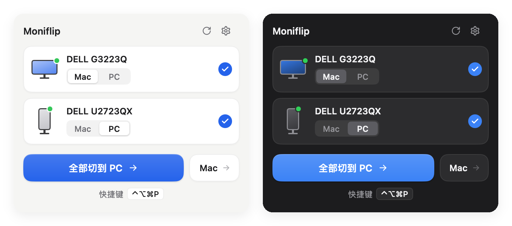
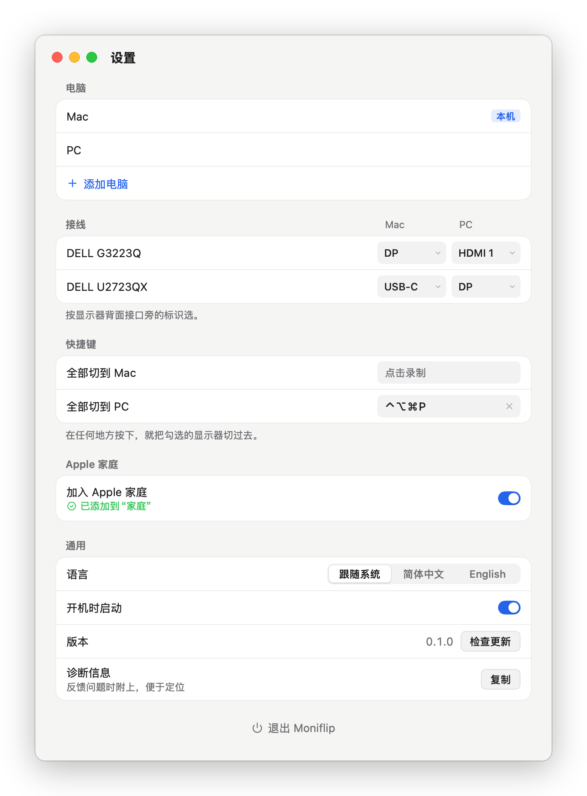

<div align="center">
  
  <h1>Moniflip</h1>
  <p><strong>一键把显示器切到另一台电脑。</strong></p>
  <p>状态栏小工具，经 DDC/CI 切换显示器输入源：不用 KVM，不用拔线，也不用翻显示器菜单。</p>
  <p>简体中文 · <a href="README_EN.md">English</a></p>
</div>

<p align="center"></p>

几台电脑共用同一组显示器时，Moniflip 在 macOS 状态栏或 Windows 托盘里显示每台显示器此刻在哪台电脑上，点一下就切过去。它发出的是和按显示器上输入源按键一样的 DDC/CI 指令（VCP 0x60）。

## 功能

- **看得见当前状态**：每台显示器一个 [Mac | PC] 切换开关，显示它正在显示哪台电脑；点另一边就把它切过去。
- **一键全切**：主按钮把勾选的显示器一起切到另一台电脑；也可以给每台电脑设一个全局快捷键。
- **一边装就能来回切**：很多显示器在显示别的电脑时，仍然接受这台电脑发来的指令，装一边就能切走再切回来。显示器不支持的话，两台电脑各装一个。
- **切完会确认**：切换后回读当前输入；显示器被自动选择输入弹回原来的口时会提示原因。
- **Apple 家庭**：扫码加入“家庭” App，作为一台“电视”，输入源就是各台电脑，可以用 Siri、场景和自动化切换。
- **适配你的接线**：电脑可以命名、增删；每台显示器分别设置各台电脑接的口，可选项读自显示器本身。同型号多台在 macOS 上按序列号区分，在 Windows 上按连接的接口区分（换接口后要重新设置接线）。
- **命令行与链接**：`moniflip switch PC`、`moniflip://switch?to=PC`，方便接 Stream Deck、快捷指令和脚本。
- 中英文界面，自动更新（更新包经签名校验）。不需要账号，不收集任何数据。

## 系统要求

- Apple 芯片的 Mac，macOS 13 及以上；或 Windows 10/11（x64）。
- 显示器菜单里开启 DDC/CI（通常默认开启）。
- Mac 上显示器要接在 USB-C、雷电或 DisplayPort 上；M1/M2 Mac 自带的 HDMI 口暂不支持。

## 安装

在 [Releases](https://github.com/qzz0518/Moniflip/releases/latest) 下载：

- **macOS**：打开 `.dmg`，把 Moniflip 拖进“应用程序”。App 已用 Developer ID 签名并经 Apple 公证。
- **Windows**：运行名字里带 `Setup` 的 `.exe`。为当前用户安装，不需要管理员权限，默认装在 `%LOCALAPPDATA%\Programs\Moniflip`；会创建开始菜单快捷方式，完成页可以选择是否创建桌面快捷方式。安装包暂未做代码签名，SmartScreen 拦截时点“更多信息 → 仍要运行”。

## 上手

<p align="center"></p>

1. 点状态栏（或托盘）里的 Moniflip 图标打开面板。第一次打开会读取显示器信息，需要几秒。
2. 点面板右上角的齿轮（或右键图标 → **设置…**）打开设置窗口。在 **电脑** 里给电脑起名，确认标着“本机”的就是这台电脑：主按钮据此决定把显示器切走还是切回来。不对的话把鼠标移到那一行，点 **设为本机**。
3. 在 **接线** 里为每台显示器选好各台电脑接的口（看显示器背面接口旁的标识）。
4. 再点图标打开面板，点卡片上的电脑名切换单台显示器，或点主按钮一起切换。
5. 想用快捷键：在 **快捷键** 里点录制框，按下组合键。组合键要带 ⌃、⌥、⌘ 之一（Windows：Ctrl、Alt、Win），或者用 F1–F12；Esc 取消，⌫（Backspace）清除。设置窗口开着时全局快捷键暂停。

右键图标（Mac 上也可以按住 Control 点按）是快捷菜单：**打开面板**、**设置…**、每台电脑一项 **全部切到 …**、**退出 Moniflip**。

界面语言跟随系统（Windows 上跟随显示语言），也可以在 设置 → **通用** → **语言** 里选 **简体中文** 或 **English**，立即生效（更新窗口下次启动时跟上）。

### Apple 家庭

1. 设置 → **Apple 家庭** → 打开 **加入 Apple 家庭**，下面会显示配对二维码和 8 位配对码。
2. 在 iPhone 的“家庭” App 里点 **添加配件**，扫描二维码；扫不了时点 **更多选项…**，选中 Moniflip，输入配对码。
3. 添加后，Moniflip 是一台“电视”，在输入源里选择电脑即可切换；也可以对 Siri 说“把 Moniflip 切换到 PC”。

运行 Moniflip 的电脑要保持唤醒，并和 iPhone（或家居中枢）在同一网络。第一次打开时 macOS 会询问是否允许访问本地网络，请选择允许；Windows 会弹出防火墙提示，请允许 Moniflip 在当前网络上通信（网络被识别为“公用”时也要勾上）。关掉 **加入 Apple 家庭** 会解除配对；再打开时会生成新的配对码，需要在“家庭” App 里重新添加。

## 命令行与链接

```sh
moniflip list [--json]             # 列出能用 DDC/CI 控制的显示器及其当前输入
moniflip switch <电脑> [显示器]    # 把勾选的显示器（或 ID 含该片段的显示器）切到这台电脑
moniflip diagnose                  # 输出诊断信息，与 设置 → 通用 → 诊断信息 → 复制 相同
moniflip version
```

`moniflip` 在 macOS 上是 `/Applications/Moniflip.app/Contents/MacOS/Moniflip`，在 Windows 上默认是 `%LOCALAPPDATA%\Programs\Moniflip\Moniflip.exe`。Windows 版是图形界面程序，命令行不会等它结束：要等它结束并拿到退出码，cmd 里用 `start /wait "" "%LOCALAPPDATA%\Programs\Moniflip\Moniflip.exe" list`，PowerShell 里在命令后面接 `| Out-Host`。

也可以打开链接 `moniflip://switch?to=PC`，加 `&monitor=<名称或 ID 片段>` 只切匹配的显示器。

## 排障

- **没反应**：检查显示器菜单里的 DDC/CI 是否开启。
- **切过去又跳回来**：目标电脑在睡眠，或那个接口没有信号，显示器自己选回了有信号的输入。先唤醒目标电脑；也可以在显示器菜单里关掉自动选择输入（Dell：Input Source → Auto Select for USB-C 设为 No 或 Prompt）。
- **检测不到显示器**：DisplayLink 扩展坞、多数 KVM 和部分转接头不传 DDC/CI，换直连线试试。
- **切不回来**：有的显示器在显示别的电脑时不接受指令。这种情况两台电脑各装一个 Moniflip，各自负责把显示器切走。
- **Windows**：请用“扩展”显示模式，“复制”模式下分不清是哪台显示器。

设置保存在 `~/Library/Application Support/Moniflip/config.json`（Windows：`%AppData%\Moniflip\config.json`），日志在 `~/Library/Logs/Moniflip/`（Windows：`%AppData%\Moniflip\logs\`）。

你的显示器不行，或者能用但没人报告过，欢迎[提交显示器报告](https://github.com/qzz0518/Moniflip/issues/new?template=monitor-report.yml)，附上诊断信息：设置 → **通用** → **诊断信息** → **复制**，或运行 `moniflip diagnose`。诊断信息里的显示器序列号已打码。

## 从源码构建

见 [CONTRIBUTING.md](CONTRIBUTING.md)。

## 致谢

Apple 芯片上的 DDC/CI 实现参考了 [m1ddc](https://github.com/waydabber/m1ddc) 和 [MonitorControl](https://github.com/MonitorControl/MonitorControl) 的做法。Moniflip 基于 [MyGo](https://github.com/egoist/mygo) 构建，Apple 家庭支持来自 [hap](https://github.com/brutella/hap)。详见 [THIRD-PARTY-NOTICES.md](THIRD-PARTY-NOTICES.md)。

## 许可

[MIT](LICENSE)
