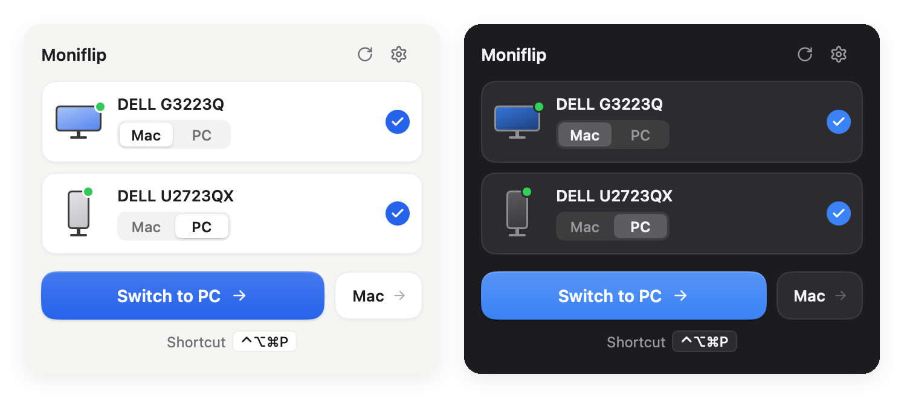
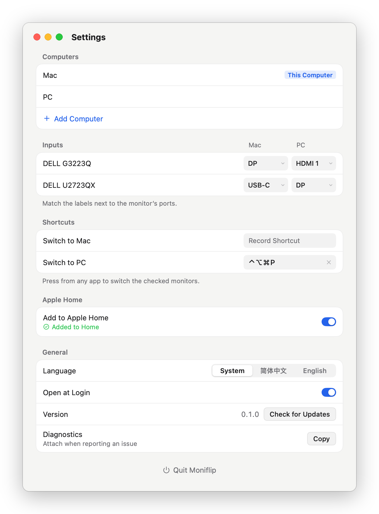

<div align="center">
  
  <h1>Moniflip</h1>
  <p><strong>Flip your monitors to another computer in one click.</strong></p>
  <p>A menu-bar utility that switches monitor inputs over DDC/CI — no KVM, no cable swapping, no on-screen menus.</p>
  <p><a href="README.md">简体中文</a> · English</p>
</div>

<p align="center"></p>

When several computers share the same monitors, Moniflip shows — in the macOS menu bar or the Windows notification area — which computer each monitor is showing, and switches it with a click. It sends the same DDC/CI command (VCP 0x60) as the input button on the monitor itself.

## Features

- **See where each monitor is**: every monitor gets a [Mac | PC] switch showing the computer it displays now; click the other side to flip it.
- **Flip everything at once**: the main button moves the checked monitors to another computer; each computer can also get a global shortcut.
- **Install on one side, switch both ways**: many monitors accept commands from a computer they are not showing, so one copy can switch away and back. If yours don't, install Moniflip on both computers.
- **Verified switching**: Moniflip reads the input back after switching and tells you when a monitor bounced back to its previous input.
- **Apple Home**: scan a code to add it to the Home app as a TV whose inputs are your computers — switch with Siri, scenes and automations.
- **Fits your wiring**: name, add and remove computers; set which input each computer uses on every monitor, from the inputs the monitor reports. Identical monitors are told apart by serial number on macOS and by connection port on Windows (redo the wiring after moving a monitor to another port).
- **Command line and links**: `moniflip switch PC`, `moniflip://switch?to=PC` — for Stream Deck, Shortcuts and scripts.
- English and Chinese, signed auto-updates. No account, no data collection.

## Requirements

- A Mac with Apple silicon and macOS 13 or later, or Windows 10/11 (x64).
- DDC/CI enabled in the monitor's menu (usually on by default).
- On a Mac, connect monitors over USB-C, Thunderbolt or DisplayPort; the built-in HDMI port of M1/M2 Macs is not supported yet.

## Install

Download the latest version from [Releases](https://github.com/qzz0518/Moniflip/releases/latest):

- **macOS**: open the `.dmg` and drag Moniflip to Applications. The app is signed with a Developer ID and notarized by Apple.
- **Windows**: run the `.exe` with `Setup` in its name. It installs for the current user without administrator rights, by default to `%LOCALAPPDATA%\Programs\Moniflip`, and creates a Start menu shortcut; the last page offers a desktop shortcut. The installer is not code-signed yet; if SmartScreen stops it, choose **More info → Run anyway**.

## Getting started

<p align="center"></p>

1. Click Moniflip in the menu bar (or notification area) to open the panel. The first time it reads your monitors, which takes a few seconds.
2. Click the gear in the panel (or right-click the icon → **Settings…**) to open the Settings window. Under **Computers**, name your computers and check that the one marked **This Computer** is the computer you are on: the main button uses it to decide whether to send the monitors away or bring them back. If it is wrong, hover over the right row and click **Set as This Computer**.
3. Under **Inputs**, choose the input each computer uses on every monitor (look at the labels next to the ports on the back of the monitor).
4. Click the icon again to open the panel. Click a computer name on a card to flip that monitor, or use the main button to flip them all.
5. For a shortcut, click a field under **Shortcuts** and press the key combination. It must include ⌃, ⌥ or ⌘ (Windows: Ctrl, Alt or Win), or be F1–F12; Esc cancels, ⌫ (Backspace) clears. Global shortcuts pause while the Settings window is open.

Right-click the icon (or Control-click on a Mac) for a menu: **Open Panel**, **Settings…**, **Switch All to …** for each computer, and **Quit Moniflip**.

The interface follows the system language (on Windows, the display language). To choose one, go to Settings → **General** → **Language** and pick **简体中文** or **English**; it applies right away (the update window follows from the next launch).

### Apple Home

1. Settings → **Apple Home** → turn on **Add to Apple Home**. A setup QR code and an 8-digit setup code appear below.
2. In the Home app on your iPhone, tap **Add Accessory** and scan the QR code; or tap **More options…**, pick Moniflip and enter the setup code.
3. Moniflip appears as a TV: choose a computer as its input to switch. You can also ask Siri, for example “Switch Moniflip to PC”.

The computer running Moniflip must stay awake and be on the same network as your iPhone (or home hub). The first time, macOS asks whether Moniflip may access the local network — allow it; on Windows, allow Moniflip through the firewall prompt (Private networks, plus Public if your network is set to Public). Turning **Add to Apple Home** off removes the pairing; turning it back on generates a new setup code, and you add Moniflip in the Home app again.

## Command line and links

```sh
moniflip list [--json]                # list DDC/CI-capable monitors and their current input
moniflip switch <computer> [monitor]  # flip the checked monitors (or those whose ID contains <monitor>)
moniflip diagnose                     # print diagnostics, same as Settings → General → Diagnostics → Copy
moniflip version
```

`moniflip` is `/Applications/Moniflip.app/Contents/MacOS/Moniflip` on macOS and, by default, `%LOCALAPPDATA%\Programs\Moniflip\Moniflip.exe` on Windows. On Windows it is a GUI app, so the shell does not wait for it: to wait and get its exit code, use `start /wait "" "%LOCALAPPDATA%\Programs\Moniflip\Moniflip.exe" list` in cmd, or append `| Out-Host` in PowerShell.

Links work too: `moniflip://switch?to=PC`, plus `&monitor=<name or ID fragment>` to flip only the matching monitors.

## Troubleshooting

- **Nothing happens**: check that DDC/CI is enabled in the monitor's menu.
- **The monitor flips back**: the target computer is asleep or that input has no signal, so the monitor picked an input with a signal. Wake the target computer first, or turn off automatic input selection in the monitor's menu (Dell: Input Source → Auto Select for USB-C → No or Prompt).
- **No monitors found**: DisplayLink docks, most KVMs and some adapters do not pass DDC/CI through; try a direct cable.
- **Cannot switch back**: some monitors ignore commands from a computer they are not showing. Install Moniflip on both computers so each one switches the monitors away from itself.
- **Windows**: use the "Extend" display mode; in "Duplicate" mode Windows cannot tell the monitors apart.

Settings live in `~/Library/Application Support/Moniflip/config.json` (Windows: `%AppData%\Moniflip\config.json`), logs in `~/Library/Logs/Moniflip/` (Windows: `%AppData%\Moniflip\logs\`).

If your monitor does not work — or works and is not reported yet — please [file a monitor report](https://github.com/qzz0518/Moniflip/issues/new?template=monitor-report.yml) with the diagnostics: Settings → **General** → **Diagnostics** → **Copy**, or run `moniflip diagnose`. Monitor serial numbers are masked in the diagnostics.

## Building from source

See [CONTRIBUTING.md](CONTRIBUTING.md).

## Acknowledgements

The DDC/CI implementation for Apple silicon follows techniques worked out by [m1ddc](https://github.com/waydabber/m1ddc) and [MonitorControl](https://github.com/MonitorControl/MonitorControl). Moniflip is built with [MyGo](https://github.com/egoist/mygo); Apple Home support comes from [hap](https://github.com/brutella/hap). See [THIRD-PARTY-NOTICES.md](THIRD-PARTY-NOTICES.md).

## License

[MIT](LICENSE)
